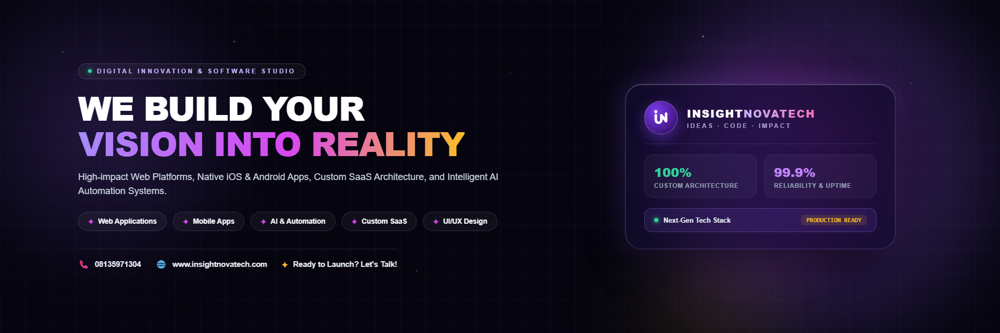

# Insightnovatech — Ideas · Code · Impact

> Official web platform for **Insightnovatech**, an innovative software engineering and digital solutions agency crafting scalable web platforms, mobile apps, SaaS architectures, and automated business workflows.



---

## 🚀 Overview

Insightnovatech turns complex challenges into high-performance digital products. Designed with modern web standards, interactive micro-animations, glassmorphism UI, and dark aesthetic brand styling.

### 🌟 Key Highlights
- **Flagship Portfolio**: Live projects showcased including **GymPilotPro**, **Reno Property Management**, **Network for Medical Missions**, **Esther Odejobi Consults**, and **Cecilia Abua Foundation**.
- **Interactive Project Modals**: Live preview links, GitHub repositories, architecture breakdowns, and tech stacks.
- **Brand Social Assets**: Includes social media flyer suite (`designs/`), avatars, and high-resolution banner graphics.
- **SEO & Social Share Ready**: Full Open Graph and Twitter Card metadata configured for rich previews on X/Twitter, LinkedIn, WhatsApp, and Slack.
- **Vercel Optimized**: Native static site routing (`vercel.json`) with clean URLs and asset caching.

---

## 🛠️ Tech Stack

- **Semantic HTML5** & **Modern Vanilla CSS3** (No bulky external CSS framework dependencies)
- **Vanilla JavaScript** for high-performance interactions, interactive project modals, and smooth filtering
- **Google Fonts**: Montserrat, Caveat, JetBrains Mono
- **Hosting**: Vercel / GitHub Pages ready

---

## ⚡ Deploying to Vercel

### Option 1: Import via Vercel Dashboard (Recommended)
1. Go to [vercel.com](https://vercel.com) and log in.
2. Click **"Add New..."** > **"Project"**.
3. Import this GitHub repository: `Sliver14/insight222`.
4. Keep the Framework Preset as **Other** (Root directory: `./`).
5. Click **Deploy**. Vercel will immediately deploy the static site from `index.html`.

### Option 2: Deploy using Vercel CLI
```bash
# Install Vercel CLI globally (if not installed)
npm i -g vercel

# Deploy directly from workspace root
vercel --prod
```

---

## 📁 Repository Structure

```text
├── index.html                   # Primary entry point for Vercel & web hosting
├── insightnovatech-v2.html       # Mirrored canonical HTML template
├── vercel.json                  # Vercel routing rules & cache headers
├── og-image.png                 # OpenGraph / social preview image (1200x630)
├── logo.png                     # Square brand logo / favicon asset
├── gympilotpro.png              # Showcase screenshot: GymPilotPro SaaS
├── reno-flyer.png               # Showcase screenshot: Reno Real Estate
├── medical-missions.png         # Showcase screenshot: Medical Missions
├── esther.png                   # Showcase screenshot: Esther Odejobi
├── cecilia-abua.png             # Showcase screenshot: Cecilia Abua Foundation
├── designs/                     # Social media flyer suite & brand banners
└── .gitignore                   # Ignored files & development artifacts
```

---

## 📬 Contact & Inquiries

- **Website**: [insightnovatech.com](https://www.insightnovatech.com)
- **Twitter / X**: [@SylvaFx](https://twitter.com/SylvaFx)
- **GitHub**: [github.com/Sliver14](https://github.com/Sliver14)
